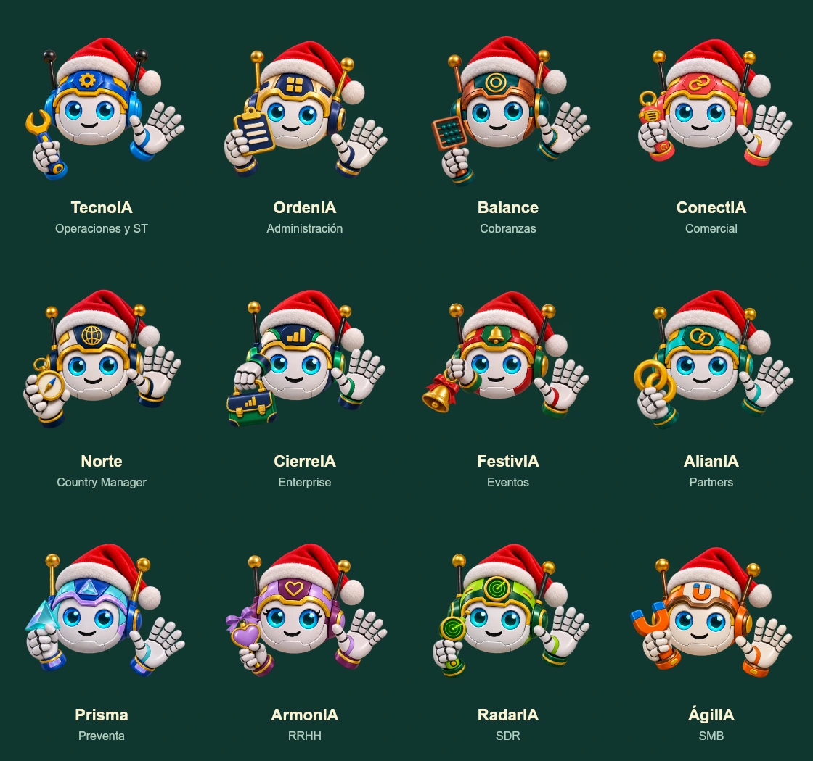

# Arte de los doce guardianes

Los once nuevos diseños se crearon con ImageGen integrado a partir del atlas aprobado de TecnoIA. Se mantiene el estilo navideño, cabeza y dos manos flotantes completas, sin cuerpo ni estrellas. Los sprites se exportan mediante Canvas desde esas piezas; las animaciones comparten un sistema de tiempos y cada personaje tiene una celebración propia.

| Personaje | Área             | Atlas fuente                                               | Sprites y metadatos                                                                                                 | Prompt                                                                                  |
| --------- | ---------------- | ---------------------------------------------------------- | ------------------------------------------------------------------------------------------------------------------- | --------------------------------------------------------------------------------------- |
| TecnoIA   | Operaciones y ST | [PNG](../../public/characters/tecnoia/rig-navidad-v1.png)  | [WebP](../../public/characters/tecnoia/sprites-v1.webp) · [JSON](../../public/characters/tecnoia/sprites-v1.json)   | [ImageGen](tecnoia/prompt-rig-v1.md)                                                    |
| OrdenIA   | Administración   | [PNG](../../public/characters/ordenia/rig-navidad-v1.png)  | [WebP](../../public/characters/ordenia/sprites-v1.webp) · [JSON](../../public/characters/ordenia/sprites-v1.json)   | [ImageGen](ordenia/prompt-rig-v1.md)                                                    |
| Balance   | Cobranzas        | [PNG](../../public/characters/balance/rig-navidad-v1.png)  | [WebP](../../public/characters/balance/sprites-v1.webp) · [JSON](../../public/characters/balance/sprites-v1.json)   | [ImageGen](balance/prompt-rig-v1.md)                                                    |
| ConectIA  | Comercial        | [PNG](../../public/characters/conectia/rig-navidad-v1.png) | [WebP](../../public/characters/conectia/sprites-v1.webp) · [JSON](../../public/characters/conectia/sprites-v1.json) | [ImageGen](conectia/prompt-rig-v1.md) · [edición final](conectia/prompt-limpieza-v1.md) |
| Norte     | Country Manager  | [PNG](../../public/characters/norte/rig-navidad-v1.png)    | [WebP](../../public/characters/norte/sprites-v1.webp) · [JSON](../../public/characters/norte/sprites-v1.json)       | [ImageGen](norte/prompt-rig-v1.md)                                                      |
| CierreIA  | Enterprise       | [PNG](../../public/characters/cierreia/rig-navidad-v1.png) | [WebP](../../public/characters/cierreia/sprites-v1.webp) · [JSON](../../public/characters/cierreia/sprites-v1.json) | [ImageGen](cierreia/prompt-rig-v1.md)                                                   |
| FestivIA  | Eventos          | [PNG](../../public/characters/festivia/rig-navidad-v1.png) | [WebP](../../public/characters/festivia/sprites-v1.webp) · [JSON](../../public/characters/festivia/sprites-v1.json) | [ImageGen](festivia/prompt-rig-v1.md)                                                   |
| AlianIA   | Partners         | [PNG](../../public/characters/aliania/rig-navidad-v1.png)  | [WebP](../../public/characters/aliania/sprites-v1.webp) · [JSON](../../public/characters/aliania/sprites-v1.json)   | [ImageGen](aliania/prompt-rig-v1.md) · [edición final](aliania/prompt-limpieza-v1.md)   |
| Prisma    | Preventa         | [PNG](../../public/characters/prisma/rig-navidad-v1.png)   | [WebP](../../public/characters/prisma/sprites-v1.webp) · [JSON](../../public/characters/prisma/sprites-v1.json)     | [ImageGen](prisma/prompt-rig-v1.md) · [edición final](prisma/prompt-limpieza-v1.md)     |
| ArmonIA   | RRHH             | [PNG](../../public/characters/armonia/rig-navidad-v1.png)  | [WebP](../../public/characters/armonia/sprites-v1.webp) · [JSON](../../public/characters/armonia/sprites-v1.json)   | [ImageGen](armonia/prompt-rig-v1.md)                                                    |
| RadarIA   | SDR              | [PNG](../../public/characters/radaria/rig-navidad-v1.png)  | [WebP](../../public/characters/radaria/sprites-v1.webp) · [JSON](../../public/characters/radaria/sprites-v1.json)   | [ImageGen](radaria/prompt-rig-v1.md)                                                    |
| ÁgilIA    | SMB              | [PNG](../../public/characters/agilia/rig-navidad-v1.png)   | [WebP](../../public/characters/agilia/sprites-v1.webp) · [JSON](../../public/characters/agilia/sprites-v1.json)     | [ImageGen](agilia/prompt-rig-v1.md)                                                     |

Especificaciones, poderes, celebraciones y reproducción de las hojas: [guía de guardianes](../../docs/guardianes-navidad.md).

El [piloto jugable TecnoIA v2](tecnoia/README-v2.md) incorpora una fuente limpia y 203 sprites, con disparo sincronizado, celebración completa de 60 fotogramas y estados combinables. Está integrado en main y [publicado en Firebase](https://geovictoria-intranet-peru.web.app/juego), con disparo y controles aceptados por el usuario en su teléfono. Incluye anclajes, recuperación ante fallos, GIF de estudio, revisión en cámara lenta y registro del despliegue. TecnoIA queda cerrado como piloto; ConectIA es el siguiente personaje. Los primeros borradores de ocho poses se conservan.
