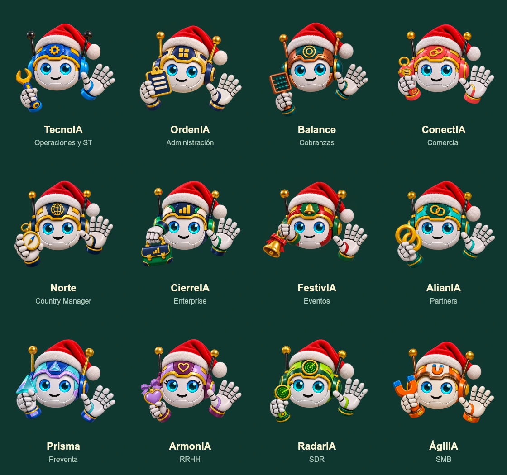

# Doce guardianes · Sprites y poderes

Entrega del 18 de noviembre de 2026 para Pausa activa 2.0. Por petición del usuario, el elenco de doce áreas se adelantó respecto al orden inicial del roadmap. Son doce personajes jugables del arcade individual; esta entrega no habilita todavía la arena multijugador ni sustituye sus pruebas de equilibrio.



## Personajes, poderes y celebraciones

Todos se eligen gratuitamente. TecnoIA conserva su esquiva; cada una de las otras once áreas tiene un poder diferente. El kit común conserva movimiento, disparo, tres vidas y el mismo tamaño de colisión. Shift y el botón táctil activan el poder del personaje seleccionado. El botón muestra texto y recarga, sin icono de rayo.

| Área             | Personaje | Poder                                                                             | Recarga | Celebración propia                       |
| ---------------- | --------- | --------------------------------------------------------------------------------- | ------- | ---------------------------------------- |
| Operaciones y ST | TecnoIA   | Esquiva: impulso breve con protección                                             | 2,5 s   | Saludo con la mano y herramienta         |
| Administración   | OrdenIA   | Barrera: bloquea proyectiles durante 3 s                                          | 9 s     | Reverencia con su portapapeles           |
| Cobranzas        | Balance   | Recuperación: restaura una vida perdida                                           | 14 s    | Balanceo alterno de las manos            |
| Comercial        | ConectIA  | Ráfaga: duplica la cadencia durante 3 s                                           | 10 s    | Celebra levantando ambas manos           |
| Country Manager  | Norte     | Tiempo lento: ralentiza enemigos y proyectiles durante 4 s                        | 12 s    | Saludo de orientación con brújula        |
| Enterprise       | CierreIA  | Gran cierre: un disparo de cuatro impactos                                        | 10 s    | Levanta el maletín y celebra la venta    |
| Eventos          | FestivIA  | Campanada: onda que elimina enemigos cercanos y daña al jefe dentro de su alcance | 12 s    | Agita su campana                         |
| Partners         | AlianIA   | Reflejo: devuelve los proyectiles cercanos durante 4 s                            | 11 s    | Presenta los anillos y alterna las manos |
| Preventa         | Prisma    | Prisma: los disparos atraviesan hasta tres objetivos durante 4 s                  | 10 s    | Presenta el cristal con giro suave       |
| RRHH             | ArmonIA   | Calma: despeja proyectiles cercanos y aleja enemigos                              | 8 s     | Corazón y saludo amable                  |
| SDR              | RadarIA   | Radar: guía los disparos durante 4 s                                              | 10 s    | Barrido de radar con saludo              |
| SMB              | ÁgilIA    | Imán: atrae mejoras cercanas durante 4 s                                          | 8 s     | Rebote alegre con el imán                |

Recuperación no consume su recarga si las tres vidas están completas. Las recargas impiden volver a activar un poder antes de tiempo. Los efectos terminan y se reinician con la partida. Las ventajas son propias del arcade casual; no se ha validado equivalencia competitiva entre áreas.

## Recursos reales, completos y reproducibles

Cada carpeta `public/characters/<id>/` contiene:

- `rig-navidad-v1.png`: arte original RGBA, sin cuerpo, cuello, brazos ni estrellas. Cabeza completa y dos manos flotantes con sus accesorios.
- `sprites-v1.webp`: hoja transparente de **3840 × 1440**, con celdas de **160 × 160**, nueve filas y hasta 24 columnas. Contiene **184 fotogramas activos por personaje**, 2.208 entre las doce áreas.
- `sprites-v1.json`: coordenadas de los fotogramas, duración y repetición de cada animación, fuente y SHA-256, rectángulos de piezas, poder y celebración.
- `portrait-v1.webp`: miniatura del personaje completo para el selector.

La composición 2×2 del PNG fuente separa piezas para animar; no limita el juego a cuatro imágenes. La hoja v1 ofrece 24 × 9 espacios. El [piloto TecnoIA v2](../design/characters/tecnoia/README-v2.md), integrado en esta rama, añade una fuente limpia, 203 sprites en páginas variables, emisor sincronizado y una celebración de 60 fotogramas con entrada, gesto, remate y salida al reposo. Se reproduce con `npm run sprites:tecnoia-game`; los once guardianes restantes conservan v1. El [roadmap](roadmap-animacion-guardianes.md) registra la validación y publicación pendientes antes de extenderlo. La celebración v1 existente tiene 48 fotogramas en un bucle de 1,4 segundos.

Las animaciones incluyen reposo (24), movimiento (24), disparo (12), esquiva (12), impacto (16), activación de poder (24), celebración (48) y descanso/derrota (24). La esquiva se usa como poder jugable de TecnoIA; las otras áreas usan su animación de poder. Los fotogramas se generan combinando las piezas y curvas del rig, con tiempos acordes a la mecánica; no son imágenes idénticas repetidas ni escenas nuevas que cambien de identidad entre fotogramas.

El juego usa las hojas exportadas durante la partida y el rig de mayor resolución en la vista previa. Si falla la hoja, puede recurrir al rig; si faltan ambas imágenes, mantiene un dibujo de respaldo y ofrece reintentar. Se carga la hoja del personaje elegido, con una caché limitada; las doce hojas completas no se descargan al entrar. El selector tiene miniaturas, búsqueda por nombre/área, clásicos separados y vista previa de los gestos.

El render interpola posiciones entre pasos de simulación y suaviza la inclinación según el movimiento. Las animaciones reinician su reloj al cambiar de acción y se congelan al pausar. El modo de efectos reducidos conserva un fotograma estable. Los personajes antiguos y los desbloqueos del dispositivo se mantienen en la colección Clásicos.

## Producción y verificación

**Mejora pendiente:** las hojas actuales reutilizan las piezas del rig y no incluyen todavía poses ilustradas de apuntado ni un emisor de disparo vinculado a la mano. El [roadmap de animación v2](roadmap-animacion-guardianes.md) aborda esta limitación personaje por personaje; tener 184 fotogramas no demuestra por sí solo una actuación convincente.

El arte se generó con **ImageGen integrado**, utilizando TecnoIA como referencia de familia visual. Los prompts originales y las ediciones finales de transparencia están en `design/characters/<id>/`. El [índice del arte](../design/characters/README.md) enlaza cada recurso. Los PNG seleccionados se conservan sin retoque en el exportador; Canvas renderiza los fotogramas a partir de sus rectángulos de origen.

Para reproducir las hojas y metadatos:

```sh
npm ci --ignore-scripts
npm run sprites
npm test
npm run build
```

La herramienta de exportación usa [@napi-rs/canvas](https://github.com/Brooooooklyn/canvas) como dependencia de desarrollo; no se incorpora al navegador. La generación no requiere llamar de nuevo a ImageGen.

La exportación y los tests inspeccionan los 2.208 fotogramas: contenido visible, margen en los cuatro lados, variación real dentro de cada clip, dimensiones, metadatos y checksum del arte fuente. Las pruebas de reglas verifican los doce poderes y su recarga, protección, alcance, disparos, recuperación e interacción con enemigos y mejoras. La revisión visual cubre las doce vistas previas y muestras de partida en escritorio y tamaños móviles; el rendimiento en los teléfonos reales del equipo sigue requiriendo un piloto.
