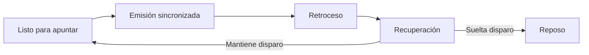

# Roadmap de animación · Guardianes con gestos y disparos claros

18 de noviembre de 2026 · Plan de mejora solicitado por el usuario. **Estado: diagnóstico realizado; implementación v2 pendiente.**

## Objetivo

Que cada guardián actúe y se exprese al jugar: que se vea cómo apunta, desde dónde dispara, cómo reacciona y cómo usa su poder. La referencia es la claridad de VictorIA Clásico, conservando el estilo navideño y la identidad aprobada de los doce guardianes.

El trabajo se hará **de uno en uno**, empezando por TecnoIA. Se termina y comprueba un personaje antes de producir el siguiente. Esta entrega documenta el plan; no cambia todavía el arte ni el juego publicado.

## 1. Diagnóstico verificado

Se revisaron la hoja original de VictorIA Clásico, el atlas de TecnoIA y el código de animación, simulación y dibujo.

| Situación actual                                                                                                           | Efecto visible                                                                                | Mejora necesaria                                                                                             |
| -------------------------------------------------------------------------------------------------------------------------- | --------------------------------------------------------------------------------------------- | ------------------------------------------------------------------------------------------------------------ |
| Clásico tiene una pose ilustrada de disparo, con mirada enfocada y emisor visible junto al auricular                       | Se entiende la acción, aunque tenga pocas poses                                               | Recuperar esa claridad con poses específicas para los guardianes                                             |
| Cada guardián parte de una cabeza, una mano con accesorio y una mano abierta                                               | La pose de presentación sigue dominando durante el combate                                    | Dibujar variantes de manos y expresiones apropiadas para cada acción                                         |
| El gesto de disparo de `sampleRig` rota y desplaza las mismas piezas                                                       | Hay movimiento, pero la mano no adopta una pose de disparo ni aparece un emisor               | Añadir apuntado, emisión, retroceso y recuperación con cambios de silueta                                    |
| El disparo normal nace de `p.x + p.width - 16`, `p.y + 60`                                                                 | El punto de salida no sigue la posición y orientación reales de una boquilla                  | Definir un punto de emisión vinculado a la pose del personaje                                                |
| El estado `shooting` se mantiene durante el disparo continuo; el animador no recibe un identificador por proyectil emitido | El bucle visual puede desalinearse con cada disparo, especialmente con Ráfaga                 | Sincronizar los gestos mediante eventos de disparo aceptados por la simulación                               |
| Las hojas actuales tienen 184 fotogramas por personaje, exportados mediante transformaciones de sus piezas                 | La cantidad de sprites no equivale a esa cantidad de poses ilustradas o expresiones distintas | Mejorar primero las poses y la puesta en escena; después decidir cuántos fotogramas necesita cada transición |

Los controles, la interpolación y las hojas actuales son una base reutilizable. Las comprobaciones de márgenes y contenido siguen siendo útiles, pero no demuestran por sí solas que una acción se entienda.

Referencias: [`Sprinn nuevo Victoria.png`](../public/Sprinn%20nuevo%20Victoria.png), [`rig.js`](../src/game/rig.js), [`simulation.js`](../src/game/simulation.js), [`animation.js`](../src/game/animation.js), [`render.js`](../src/game/render.js), [`ActiveBreak.jsx`](../src/components/ActiveBreak.jsx).

## 2. Dirección visual propuesta

### Formato de las hojas: qué significa 2×2 o 4×4

Se verificaron los archivos y metadatos de los doce guardianes. La estructura actual es:

| Recurso                          | Distribución                                 | Contenido real                                                                                                   |
| -------------------------------- | -------------------------------------------- | ---------------------------------------------------------------------------------------------------------------- |
| Referencia VictorIA Clásico      | 2 columnas × 2 filas                         | Cuatro poses ilustradas diferentes                                                                               |
| Atlas de piezas de cada guardián | Composición 2×2, PNG de 1254 × 1254          | Cabeza completa, mano con accesorio, mano abierta y un espacio vacío; no es una secuencia de cuatro fotogramas   |
| Hoja de animación actual         | 24 columnas × 9 filas, WebP de 3840 × 1440   | 216 espacios de 160 × 160; se usan 184 fotogramas y los espacios restantes quedan libres                         |
| Celebración actual               | Dos filas de 24 fotogramas dentro de la hoja | 48 fotogramas reproducidos en un bucle de 1,4 segundos, aproximadamente 34,3 fotogramas de animación por segundo |

La frecuencia de una secuencia de animación es distinta de la frecuencia de dibujo del juego. Las dimensiones de la cuadrícula son una forma de empaquetar imágenes; cambiar de 2×2 a 4×4 no determina por sí solo la calidad.

**Para v2 se incorpora el formato 4×4 como plancha de revisión de 16 fotogramas por bloque.** Cada bloque mostrará el personaje completo en poses consecutivas, numeradas y en el orden de reproducción. Se podrán usar varios bloques para una acción. Por ejemplo, una celebración de 48 fotogramas puede revisarse como **tres planchas 4×4**; no se limitará a 16 fotogramas por tener una cuadrícula de cuatro filas y cuatro columnas.

El atlas de distribución para el juego podrá agrupar esos mismos fotogramas de otra forma si mejora el tamaño y la carga. Los metadatos definirán su orden, duración y puntos de anclaje. El atlas de piezas seguirá separado de las hojas de secuencias completas.

**Disparo básico:** un proyector compacto de energía integrado en la **mano libre**, con boquilla circular reconocible. La mano deja de saludar, se orienta hacia la derecha del escenario y adopta una pose de apuntado. La otra mano conserva la llave, maletín, campana o accesorio de su área.

Esta es la propuesta para desarrollar con el piloto, todavía no un recurso producido. El proyector tendrá materiales y colores de cada guardián, manteniendo un funcionamiento común. No se convertirá automáticamente cada accesorio en un arma: por ejemplo, la llave de TecnoIA y el maletín de CierreIA conservarán su lectura original.

Reglas que continúan vigentes:

- Solo cabeza y dos manos flotantes, sin cuerpo, cuello, hombros ni brazos.
- Ninguna estrella en personajes, accesorios o efectos propios. Sin icono de rayo en el botón del poder.
- Cabeza, antenas, gorro, dedos y accesorios completos, con transparencia limpia.
- Conservar nombres, paletas y personalidad. Enterprise sigue siendo **CierreIA**, relacionado con ventas y grandes cuentas.
- Mantener los poderes existentes, sus recargas, daño, reglas de puntuación y tamaño de colisión durante esta mejora visual. Cualquier cambio de mecánica se tratará por separado.
- El arcade actual dispara hacia la derecha, también al desplazarse hacia la izquierda o verticalmente. Las poses de apuntado respetarán esa dirección.

## 3. Primera entrega · TecnoIA v2

### A. Poses clave antes de exportar sprites

Preparar una lámina de TecnoIA con variaciones coherentes de la misma identidad:

1. Reposo: manos relajadas y flotación suave.
2. Listo para disparar: mirada enfocada, mano libre orientada y proyector desplegado.
3. Emisión: boquilla visible, gesto decidido y destello breve.
4. Retroceso: reacción pequeña de la mano, dedos y cabeza.
5. Recuperación: regreso a la pose de apuntado al mantener el disparo, o al reposo al soltarlo.
6. Movimiento en combate: inclinación y desplazamiento de las manos sin perder la dirección de disparo.
7. Esquiva: pose recogida con un gesto propio, seguida de recuperación clara.
8. Impacto, celebración y descanso: expresiones y posiciones nuevas donde el rig actual no comunique suficientemente la acción.

El primer objetivo son poses legibles. Se reutilizarán curvas y piezas para unirlas, sin generar cada fotograma como una imagen independiente que pueda cambiar de rostro, dedos o proporciones.

### B. Secuencia de disparo

La preparación visual debe ser breve. El destello, el sonido y el proyectil compartirán el instante de emisión. No se añadirá una espera decorativa que haga sentir lento el control: si la simulación acepta el disparo inmediatamente, la animación empezará en el fotograma adecuado de emisión y recuperará después la pose armada.

### C. Punto de salida y sincronización

- Añadir a los metadatos de cada pose el anclaje de la mano, la boquilla y su dirección; usar coordenadas locales y transformaciones compartidas.
- Calcular la salida en la simulación después del movimiento del paso correspondiente. El render utilizará ese mismo contrato de pose y anclaje, incluida la inclinación visual que afecte a la mano.
- Registrar un evento por disparo aceptado con identificador, paso de simulación, origen y tipo de disparo. El sonido y el efecto visual consumirán ese evento; dibujar un fotograma no creará proyectiles.
- Corregir los desfases de interpolación entre el actor y la emisión. No obtener la posición física del proyectil de un reloj de render variable.
- Sincronizar también disparo doble, abanico, disparo guiado, Reflejo y Gran cierre. Ráfaga deberá acompañar su cadencia más rápida sin limitarla con una animación más larga.
- Permitir que apuntado y retroceso se combinen con movimiento, impacto y poder mediante prioridades explícitas. Recibir daño o pausar no debe duplicar, perder ni dejar pendientes disparos.
- En efectos reducidos, conservar una pose de apuntado y una salida reconocibles aunque se suprima el balanceo o el destello intenso.

### D. Entrega comprobable del piloto

La entrega incluirá planchas 4×4 para revisar el ciclo de disparo y la celebración, además de sus hojas y metadatos jugables. Una plancha representa el personaje completo en cada celda; no se presentará un atlas de piezas como si fuera una secuencia animada.

TecnoIA v2 tendrá fuentes de las nuevas poses, hoja de sprites, metadatos de animación/anclajes, miniatura coherente y una muestra dentro del juego. La vista previa mostrará el ciclo completo con emisión visual, para que «Disparando» enseñe de dónde sale el proyectil. Esa demostración no guardará puntos ni modificará una partida.

Se probarán primero el disparo individual y continuo, después sus combinaciones con movimiento y esquiva. Solo se extenderá la plantilla cuando se cumplan los criterios de calidad de este documento.

### E. Celebración completa de TecnoIA v2

La celebración es una entrega obligatoria del piloto, con poses y expresiones específicas. Tendrá una secuencia con principio y final:

1. **Entrada:** pasa de la pose de combate a una expresión alegre, relaja el proyector y prepara el gesto.
2. **Gesto principal:** levanta su llave y acompaña la acción con mirada, cabeza y posición de dedos; conserva el accesorio y las proporciones.
3. **Saludo:** la mano libre adopta una pose real de saludo, con variaciones de dedos y palma, coordinada con una expresión de celebración.
4. **Remate:** una pausa breve y legible que permita reconocer la victoria.
5. **Salida:** baja suavemente las manos y vuelve a una pose tranquila mientras la pantalla de resultados permanece disponible.

**Objetivo inicial:** al menos 48 fotogramas con cambios visibles distribuidos entre esas fases. Se evaluará una secuencia de 48–72 fotogramas a 24 fotogramas de animación por segundo, aproximadamente 2–3 segundos; el piloto fijará los tiempos definitivos. Los fotogramas intermedios se producirán desde poses clave y transiciones coherentes. No basta con repetir o rotar una única mano ni con acelerar un bucle para aumentar la cifra de FPS.

Entrada y salida serán secuencias de una sola reproducción. Si se decide mantener una parte central en bucle, tendrá un enlace continuo y no repetirá toda la entrada. Los botones de resultados seguirán respondiendo durante la animación. En efectos reducidos se mostrará una pose de victoria reconocible sin exigir reproducir la secuencia completa.

La revisión se hará en velocidad normal, en cámara lenta para detectar saltos y al tamaño real dentro del juego. Se comprobarán el inicio, los cambios de gesto, la unión con el reposo, los dedos, el rostro y el encuadre. Se conservará una muestra sin audio para poder valorar el gesto por sí mismo.

**Condición de salida del piloto:** completar y verificar tanto el disparo como esta celebración antes de pasar a ConectIA. Después, cada guardián recibirá su propia secuencia completa siguiendo su personalidad y accesorio; no se copiará el mismo saludo a los doce.

## 4. Ciclo para cada personaje

| Paso                   | Entrega                                                                 | Condición para avanzar                                                 |
| ---------------------- | ----------------------------------------------------------------------- | ---------------------------------------------------------------------- |
| Diseño de poses        | Lámina con apuntado, emisión, retroceso, poder y celebración            | La acción se entiende por la pose, incluso sin efectos                 |
| Arte consistente       | Manos y expresiones nuevas con la identidad existente                   | Sin dedos extra, partes incompletas ni cambios accidentales de rostro  |
| Animación              | Transiciones y tiempos ajustados a sus acciones                         | No parece una imagen inmóvil oscilando; entrada y salida no dan saltos |
| Integración            | Boquilla, evento de disparo, efectos y poder conectados                 | Cada proyectil nace del lugar correcto y acompaña su gesto             |
| Verificación           | Pruebas de reglas/anclajes y revisión visual en tamaños reales de juego | No cambia la cadencia, el daño ni la colisión; se lee en móvil         |
| Publicación individual | Fuentes, sprites, metadatos y código versionados en GitHub              | Se verifica lo publicado antes de iniciar el siguiente guardián        |

Las observaciones del usuario se incorporarán al personaje activo. **Límite de trabajo: un guardián en producción a la vez.** Una corrección de plantilla se comprueba en los personajes ya terminados; no se regeneran automáticamente los doce.

## 5. Orden propuesto, uno por uno

| Turno | Personaje                  | Foco específico después del disparo común                                           |
| ----- | -------------------------- | ----------------------------------------------------------------------------------- |
| 1     | TecnoIA · Operaciones y ST | Validar el proyector, la expresión de apuntado y la esquiva                         |
| 2     | ConectIA · Comercial       | Sincronizar la Ráfaga rápida sin perder retroceso ni claridad                       |
| 3     | CierreIA · Enterprise      | Diferenciar el disparo normal de Gran cierre; gesto comercial y maletín conservados |
| 4     | Prisma · Preventa          | Conectar la pose del cristal y el efecto de penetración                             |
| 5     | RadarIA · SDR              | Coordinar activación del radar, mirada y proyectiles guiados                        |
| 6     | FestivIA · Eventos         | Hacer visible el toque de campana que inicia la Campanada                           |
| 7     | ArmonIA · RRHH             | Gesto de Calma y expresión amable distintos del disparo normal                      |
| 8     | OrdenIA · Administración   | Colocación clara de la Barrera y recuperación de la mano                            |
| 9     | Balance · Cobranzas        | Gesto de Recuperación con ábaco y señal visual de la vida recuperada                |
| 10    | AlianIA · Partners         | Activación de Reflejo y devolución visible de los proyectiles                       |
| 11    | Norte · Country Manager    | Gesto de brújula y activación reconocible de Tiempo lento                           |
| 12    | ÁgilIA · SMB               | Activación del imán, atracción de mejoras y celebración alegre                      |

Los turnos 2 y 3 sirven para comprobar dos exigencias distintas de la plantilla: disparo muy rápido y disparo especial potente. El resto avanza individualmente con sus mismos criterios. Este orden es una propuesta; no implica producir las doce variantes a la vez.

## 6. Criterios de calidad

Un personaje se considera listo cuando:

- **Se reconoce el disparo:** cambia la pose de la mano y la expresión; el emisor se distingue al tamaño real de juego, no solo en una imagen ampliada.
- **Se ve su origen:** el centro del primer tramo del proyectil coincide con la boquilla. Se revisa al moverse, al disparar continuamente y al utilizar mejoras.
- **Hay reacción:** el retroceso y la recuperación son visibles sin hacer vibrar toda la cabeza ni bloquear los controles.
- **Cada disparo corresponde a un evento:** no se pierde sincronía al cambiar de FPS, pausar/reanudar o activar Ráfaga. El disparo doble y el abanico no generan varios retrocesos desordenados por una sola descarga.
- **El poder y la celebración tienen poses propias:** la celebración conserva su gesto distintivo y se mejora su actuación; añadir fotogramas idénticos o más balanceo no satisface este punto.
- **Todo el personaje está completo:** sin cortes, halos rectangulares, piezas que atraviesen el rostro, dedos adicionales, cuerpo o estrellas.
- **Se puede jugar con claridad:** efectos contenidos, sonido opcional y alternativa de movimiento reducido. Se comprueban tamaños de navegador de escritorio y móvil y después dispositivos reales del equipo.
- **Hay evidencia visual y funcional:** lámina de poses, secuencia de disparo sin audio, muestra jugable y comprobaciones de anclajes, tiempos y reglas.

Las pruebas automáticas de cantidad de frames, alfa y márgenes se conservarán. Se añadirán pruebas de sincronización, anclajes y persistencia de las reglas existentes. La valoración del gesto seguirá necesitando inspección visual.

## 7. Versionado, alcance y siguiente acción

Los recursos se publicarán como v2 junto a la v1 existente, con metadatos explícitos por personaje. El catálogo podrá mezclar guardianes v1 y v2 durante el avance. Si falla un recurso nuevo, la recuperación conservará una representación completa y un anclaje válido, sin dibujar un proyector invisible que emita desde otro lugar.

El piloto definirá la cantidad final de poses, fotogramas, tamaño de celdas y presupuesto de carga, partiendo de las planchas 4×4 y del objetivo de celebración completa de la sección 3.E. Se medirá el peso de las variantes y su legibilidad antes de repetirlas. No se prometen plazos para los doce personajes sin conocer ese resultado.

**Siguiente acción:** producir la lámina de poses de **TecnoIA v2**, empezando por mano/proyector y expresión de apuntado; después integrar y comprobar su ciclo de disparo. Esta acción sigue pendiente. Historia y multijugador continúan en el [roadmap general](roadmap-videojuego.md); la prioridad inmediata es mejorar la actuación del elenco actual.
