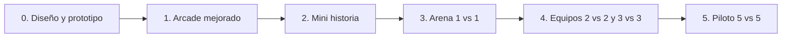
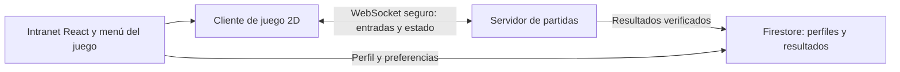

# Roadmap del videojuego · VictorIA: Operación Estrella

Propuesta de producto y desarrollo · 18 de noviembre de 2026.

**Objetivo:** convertir la pausa activa en un juego breve, agradable de controlar y con identidad propia; después incorporar una arena multijugador que avance desde 1 contra 1 hasta 5 contra 5.

Este documento propone el alcance. Las funciones descritas como próximas todavía no están implementadas. Cada etapa se valida con una versión jugable antes de ampliar el alcance; las fechas y el presupuesto se estimarán con los resultados del primer prototipo.

**Avance del 18 de noviembre:** la primera entrega jugable de la etapa 1 incorpora controles consistentes, pausa, colisiones y protección tras daño, HUD, audio configurable y el piloto TecnoIA con siete estados de animación. La [ficha de Pausa activa 2.0](pausa-activa-2.md) distingue lo implementado de la validación con dispositivos reales y las etapas pendientes. El mapa/prototipo de arena de la etapa 0 y el multijugador siguen pendientes.

**Ampliación del elenco:** a petición del usuario se adelantaron los doce personajes por área, con poderes propios, celebraciones distintas y hojas de sprites reales. La [guía de guardianes](guardianes-navidad.md) recoge la entrega y sus límites; el [catálogo actualizado](personajes-por-area.md) sustituye las fichas conceptuales. No se ha habilitado multijugador ni validado el equilibrio de esos poderes para competición.

## 1. Punto de partida verificado antes de Pausa activa 2.0

La revisión inicial encontró un arcade de disparos lateral en Canvas, integrado en React, con movimiento por teclado y joystick táctil, tres vidas, enemigos, mejoras temporales, un jefe, dos personajes, monedas locales y envío del puntaje a Firestore. La tabla conserva los hallazgos que motivaron la etapa 1; el estado posterior está en la ficha de la entrega.

| Hallazgo en el código                                                                          | Consecuencia                                                                                      | Prioridad propuesta                                         |
| ---------------------------------------------------------------------------------------------- | ------------------------------------------------------------------------------------------------- | ----------------------------------------------------------- |
| Movimiento, aparición de enemigos y duración de mejoras avanzan por fotogramas                 | La velocidad y dificultad pueden variar entre dispositivos y frecuencias de pantalla              | P0: simulación con tiempo fijo y render independiente       |
| No hay estado de pausa ni limpieza de teclas al perder el foco                                 | La persona puede perder el control al cambiar de ventana                                          | P0: pausa, reinicio de entradas y recuperación              |
| El daño no tiene un periodo propio de invulnerabilidad; solo lo bloquea el escudo              | Varios impactos cercanos pueden consumir vidas sin margen de reacción                             | P0: breve protección tras recibir daño y señal visual clara |
| Se eliminan objetos con `splice` dentro de recorridos de colisiones                            | Riesgo de saltar elementos o procesar impactos de forma inconsistente                             | P0: resolver impactos y eliminaciones en pasos separados    |
| Simulación, dibujo, controles, selector y guardado comparten un componente de unas 1550 líneas | Añadir niveles y red resulta difícil de probar y mantener                                         | P0: separar responsabilidades                               |
| Monedas y desbloqueos se guardan en el navegador; el ranking acepta el puntaje del cliente     | Sirve como progreso casual local; el competitivo necesitará resultados calculados por el servidor | P1: progreso de perfil y resultados de arena verificados    |

Referencias locales: [`ActiveBreak.jsx`](../src/components/ActiveBreak.jsx), [`GamePage.jsx`](../src/components/GamePage.jsx), [`firestore.rules`](../firestore.rules).

## 2. Concepto recomendado

**Nombre provisional:** VictorIA: Operación Estrella.

La Estrella de Navidad mantiene encendidas las luces de Villa Victoria. Una anomalía llamada **Desfase** rompe su energía en fragmentos y descontrola los robots del taller. VictorIA debe recuperarlos, reparar las rutas y poner en marcha el trineo antes de la gran celebración.

VictorIA conserva su **cabeza y manos flotantes, sin torso ni brazos**. La identidad visual combina rojo navideño, verde pino, blanco nieve y dorado. Ningún personaje llevará estrellas en accesorios, emblemas, herramientas ni efectos propios. Los indicadores usan también símbolos y formas para distinguir equipos y objetivos.

La historia se cuenta con una introducción breve que pueda saltarse, señales durante el juego y un cierre por misión. La acción sigue siendo el centro de la experiencia.

### Doce personajes, uno por categoría del directorio

El elenco objetivo incorpora un personaje por cada una de las doce categorías del directorio, según la elección del usuario. Todos conservarán la identidad de cabeza y manos flotantes, con nombres, emblemas, accesorios y animaciones reconocibles. Las primeras versiones comparten el kit de juego; las habilidades propias se prueban por roles al introducir equipos. El [catálogo de personajes por área](personajes-por-area.md) contiene las doce propuestas, el proceso de arte/animación y los criterios de aceptación.

El piloto TecnoIA permitió validar la plantilla; por petición del usuario el selector individual ya se amplió a las doce categorías. Para la arena se deberán adaptar y probar sus perspectivas, efectos y habilidades. Doce personajes disponibles no significa doce jugadores simultáneos: la capacidad objetivo sigue siendo diez.

### Una primera campaña pequeña

| Misión                  | Objetivo jugable                                        | Novedad                                                                |
| ----------------------- | ------------------------------------------------------- | ---------------------------------------------------------------------- |
| 1. Las luces del bosque | Recuperar fragmentos y llegar al faro                   | Aprender movimiento, disparo y esquiva con ayudas dentro de la partida |
| 2. El taller congelado  | Activar interruptores y proteger un generador           | Alternar ataque, defensa y una mejora temporal                         |
| 3. El último encendido  | Recuperar la estrella y detener al Guardián del Desfase | Jefe con ataques anunciados y fases reconocibles                       |

Duración objetivo: **2–4 minutos por misión**, ajustable después de probarla. Los nombres y la historia son propuestas originales de esta planificación, no contenido ya aprobado o producido.

## 3. Multijugador: una arena que pueda crecer

Propongo una **arena 2D con vista desde arriba**. Es un modo adicional al arcade lateral: esta cámara permite leer mejor a diez participantes, las rutas y los objetivos. Se reutilizan la identidad, los efectos y parte del arte; las animaciones de dirección necesitarán recursos adaptados.

**Primer modo: Carga el faro.** Recoge una chispa del centro y llévala a tu base. Puedes interceptar al rival, esquivar y proteger a quien transporta la chispa. Gana el equipo que complete cinco entregas o tenga más al terminar tres minutos. Si hay empate, se juega una prórroga de treinta segundos; si persiste, se registra empate.

La arena forma parte de un simulador de entrenamiento de los Guardianes de la Estrella, conectando la competición amistosa con la historia.

| Formato                    | Cómo se juega                                        | Cuándo incorporarlo                            |
| -------------------------- | ---------------------------------------------------- | ---------------------------------------------- |
| 1 vs 1                     | Arena simétrica, mismo equipo inicial y rutas cortas | Primer prototipo multijugador                  |
| 2 vs 2 y 3 vs 3            | Cooperación, cobertura y dos rutas                   | Después de validar sincronización y reconexión |
| 4 vs 4 y 5 vs 5            | Mapa más amplio, tres rutas y objetivos legibles     | Después del piloto por equipos                 |
| Cooperativo contra un jefe | Varias personas ayudan a restaurar la estrella       | Expansión opcional posterior                   |

Kit inicial: movimiento, disparo sencillo y esquiva con recarga. Los equipos se distinguen con color, emblema y nombre. La participación premia entregas y asistencias; los desbloqueos iniciales son cosméticos. El objetivo es que las personas puedan contribuir sin ser expertas en juegos de disparos.

## 4. Roadmap por entregas

### Etapa 0 · Definir la experiencia

**Entrega:** una ficha de juego, un mapa de arena en boceto y un prototipo de movimiento sin arte definitivo.

- Decidir dispositivos prioritarios, orientación móvil y tamaño de los controles.
- Fijar velocidad, alcance, esquiva, tamaño de colisiones y duración de la partida.
- Inventariar los recursos actuales y definir animaciones de VictorIA y señales de daño/objetivo.
- Definir las doce fichas de personajes por categoría, su plantilla visual y las piezas que podrán compartir para animación.
- Probar la arena propuesta con unas pocas personas antes de producir todo el arte.

**Criterio de salida:** el objetivo se entiende y moverse resulta cómodo en una computadora y un teléfono representativos del equipo. Se elige la dirección visual y se estima la siguiente entrega con ese alcance concreto.

### Etapa 1 · Hacer que el arcade actual se sienta mejor

**Entrega:** Pausa activa 2.0, todavía individual.

- Separar simulación, dibujo, entrada, audio y guardado.
- Simulación con tiempo fijo, movimiento diagonal normalizado y reinicio consistente.
- Pausa con Escape y botón visible; al perder el foco, limpiar entradas y pausar la partida individual.
- Colisiones previsibles, protección breve tras daño y ataques del jefe anunciados antes de impactar.
- Carga de recursos antes de jugar y recuperación cuando falte una imagen.
- HUD compacto: vidas, objetivo, puntos y mejoras con tiempo restante.
- Controles táctiles con zona segura, tamaño ajustable y opción de disparo asistido para móvil.
- Sonidos de impacto, recogida y victoria; controles de volumen y efectos reducidos.
- Integrar un personaje piloto completo con animaciones de reposo, movimiento, disparo, esquiva, daño, victoria y derrota.

**Criterio de salida:** la misma simulación mantiene velocidad y duración a distintas tasas de render; no quedan teclas activadas tras cambiar de ventana; se puede completar y reiniciar una partida en escritorio y móvil sin controles tapados.

### Etapa 2 · Añadir la mini historia y progresión

**Entrega:** las tres misiones de Operación Estrella.

- Tutorial integrado, selección de misión, objetivos y final propio.
- Enemigos con dos o tres patrones claros; jefe con fases y dificultad ajustable.
- Puntos de control apropiados para sesiones breves.
- Recompensas cosméticas, pantalla de resultados y motivo para volver a jugar.
- Separar el progreso casual local de cualquier clasificación competitiva verificada.
- Integrar los personajes ya producidos en las misiones y validar su progresión. El elenco del arcade se adelantó en la entrega de guardianes.

**Criterio de salida:** al menos ocho de diez personas del piloto pueden iniciar la primera misión sin ayuda. Se recoge su opinión sobre controles, claridad y ganas de repetir antes de ampliar contenido.

### Etapa 3 · Probar la arena 1 vs 1

**Entrega:** una arena, un modo, un kit de habilidades y salas privadas por enlace/código.

- Crear/unirse, elegir alias, marcar «listo», cuenta regresiva, resultado y revancha.
- Servidor que calcula movimiento permitido, impactos, recargas, objetivos y resultado.
- Interpolación de rivales y respuesta local de movimiento con corrección del servidor.
- Reconexión con ventana de gracia propuesta de quince segundos; caducada, resolución explícita del abandono.
- Indicador de conexión, límite de mensajes y rechazo de entradas imposibles o repetidas.
- Adaptar los personajes del piloto a la cámara de la arena, con el mismo kit y tamaño de colisión jugable.

**Criterio de salida:** diez partidas consecutivas entre dos dispositivos con resultado idéntico en ambos; una desconexión y una recarga pueden recuperarse; enviar desde un cliente una posición, daño o puntaje inventado no altera el estado autorizado.

### Etapa 4 · Introducir juego por equipos

**Entrega:** 2 vs 2 y 3 vs 3 sobre la misma base.

- Equipos equilibrados al empezar, emblemas, aliados visibles y reaparición protegida.
- Entregas y asistencias, mensajes rápidos predefinidos y cámara que mantenga legible el objetivo.
- Mapa con dos rutas, distribución de recursos y prueba de equilibrio.
- Ampliar el elenco por tandas y probar habilidades agrupadas por roles; cada incorporación se valida antes de habilitarse en competición.
- Política visible para abandonar y reconectar. Cambiar de pestaña no pausa la partida de los demás.

**Criterio de salida:** seis personas pueden completar varias partidas, entienden quién lleva la chispa y pueden recuperarse de una baja o desconexión sin bloquear la sala.

### Etapa 5 · Validar y publicar hasta 5 vs 5

**Entrega:** selector de tamaño de equipo de uno a cinco y una arena preparada para diez participantes.

- Ajustar mapa, recursos, efectos y tiempos de reaparición para cada tamaño de equipo.
- Modo espectador para proyectar una partida y panel de resultados compartible.
- Resultados escritos por el servidor, historial de partidas e idempotencia al guardar.
- Pruebas con diez personas, latencia simulada y los dispositivos reales del equipo.
- Medir consumo y definir capacidad de salas simultáneas, alojamiento y presupuesto operativo.
- Completar los doce personajes por categoría y verificar sus animaciones y efectos dentro de una partida de diez jugadores.

**Criterio de salida:** piloto completo de diez jugadores con ganador consistente, reconexión, rendimiento aceptable y consumo medido. Meta inicial de render: 60 FPS en el equipo de escritorio de referencia y al menos 30 FPS en el móvil elegido; se consideran objetivos de validación, no garantías para cualquier dispositivo.

## 5. Arquitectura propuesta

- **React** conserva navegación, acceso, perfil y pantallas de la intranet.
- **Phaser** es el candidato para escenas, animaciones, entrada y física sencilla del cliente. Se evaluará en un prototipo; la etapa de estabilidad puede comenzar separando el Canvas actual. Phaser documenta escenas pausables y sistemas de física para juegos 2D. [Escenas](https://docs.phaser.io/phaser/concepts/scenes), [Arcade Physics](https://docs.phaser.io/phaser/concepts/physics/arcade).
- **Node.js + Colyseus** es mi candidato para salas y sincronización. Su modelo mantiene el estado en el servidor y sincroniza cambios con clientes, y dispone de mecanismos de reconexión. La validación del juego sigue siendo responsabilidad de nuestra implementación. [Sincronización](https://docs.colyseus.io/state), [Reconexión](https://docs.colyseus.io/room/reconnection).
- **Simulación compartida y comprobable:** reglas de movimiento, colisiones y recargas separadas del dibujo. La física local ayuda a mostrar el juego; el servidor resuelve la partida y valida intenciones, sin aceptar directamente el resultado enviado por un navegador.
- **Firestore** se reserva en esta propuesta para progreso, preferencias e historial. Posiciones y disparos circulan por el servidor de partidas. La presencia en sala también se resolvería allí; Firestore no ofrece presencia nativa. [Documentación de presencia](https://firebase.google.com/docs/firestore/solutions/presence).

La arena empieza como módulo independiente con acceso desde el juego. Así se pueden probar cambios de motor y red por etapas. Antes de fijar versiones se revisarán las APIs vigentes y la compatibilidad del prototipo.

## 6. Coste, capacidad y decisiones pendientes

El multijugador necesita un servicio que ejecute el servidor de partidas; el alojamiento estático actual cubre el cliente. El software propuesto permite prototipar localmente, pero el servicio en línea tiene consumo y un coste que habrá que medir.

**Capacidad inicial propuesta:** una sala de hasta diez jugadores. La cantidad de salas simultáneas y la ubicación del servidor se decidirán con el piloto, midiendo latencia desde las redes que utilizará el equipo. Se compararán opciones de alojamiento y su coste vigente antes de elegir una.

Las decisiones que más cambian el alcance son: priorizar computadora o móvil, validar la cámara cenital para la arena, confirmar «Carga el faro» como primer modo y elegir cuánto peso dar a la historia. El roadmap usa estas propuestas como punto de partida; la primera etapa permite ajustarlas con una prueba jugable.

## 7. Primera entrega recomendada

Empezar por **Pausa activa 2.0**: controles consistentes, pausa, colisiones y daño justos, HUD claro, sonido configurable y estructura preparada para niveles. Después producir la primera misión del bosque como muestra de la historia. Con esa base probada, abrir el prototipo 1 vs 1 y medirlo antes de ampliar equipos.

Cada entrega futura tendrá su cambio revisable en GitHub, comprobaciones correspondientes y publicación de la versión que se haya validado. El roadmap no contrata infraestructura. Las entregas jugables implementadas se registran en su ficha correspondiente.
